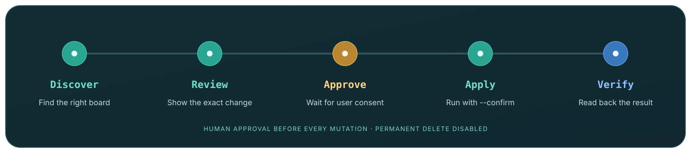
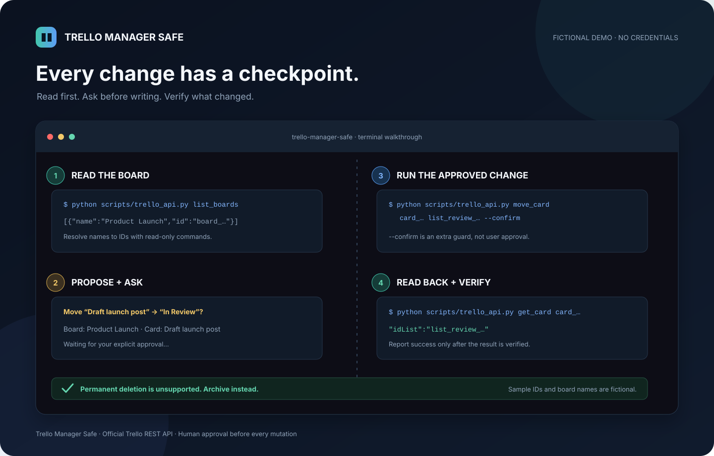

# Trello Manager Safe

[English](README.md) · [Bahasa Indonesia](README.id.md)

Skill AI agent yang membantu memeriksa dan mengelola Trello dengan aman melalui REST API resmi Trello.



> Repo ini berisi skill agent dan helper CLI Python. Ini bukan website, Trello Power-Up, atau produk resmi Atlassian.

> **Kompatibilitas agent:** Dirancang untuk agent yang mendukung format Agent Skills (SKILL.md) dan dapat menjalankan script Python lokal. Cara instalasi dan setup environment berbeda di tiap agent.

## Isi

- [Ambil skill](#ambil-skill)
- [Lisensi](#lisensi)
- [Panduan setup](#panduan-setup)
- [Fitur](#fitur)
- [Cara kerja aman](#cara-kerja-aman)
- [Contoh interaksi](#contoh-interaksi)
- [File repo](#file-repo)
- [Demo](#demo)
- [Mulai cepat](#mulai-cepat)
- [Pasang sebagai skill agent](#pasang-sebagai-skill-agent)
- [Autentikasi dan keamanan](#autentikasi-dan-keamanan)
- [Dokumentasi resmi](#dokumentasi-resmi)

## Ambil skill

Clone repo ini ke komputer. Jika perintah `git` belum tersedia, pasang [Git](https://git-scm.com/downloads) terlebih dahulu:

```powershell
git clone https://github.com/Mufid2225/trello-manager-safe.git
cd trello-manager-safe
```

Perintah ini bisa dijalankan di PowerShell, terminal macOS, atau Linux yang sudah memiliki Git. Alternatifnya, pilih **Code → Download ZIP** di GitHub, ekstrak file, lalu buka terminal di folder `trello-manager-safe` hasil ekstrak. Clone disarankan agar salinan lokal dapat diperbarui nanti dengan `git pull`.

Simpan folder hasil clone di komputer. File skill ada di `SKILL.md`, `scripts/`, dan `agents/`. Skill ini memakai Python, jadi tidak memerlukan `npx` atau installer shell jarak jauh.

## Fitur

- Melihat board, list, card, label, dan checklist.
- Membuat dan memperbarui board, list, card, label, dan item checklist.
- Memindahkan, mengarsipkan, dan memulihkan board, list, atau card.
- Mengunci penghapusan permanen lewat helper CLI.

## Cara kerja aman

1. Agent memakai operasi baca untuk mencocokkan nama dengan ID.
2. Sebelum perubahan, agent menyebutkan target dan perubahan yang akan dilakukan.
3. Agent meminta persetujuan eksplisit untuk setiap perubahan. Perubahan massal memerlukan persetujuan tersendiri.
4. Setelah disetujui, perintah perubahan dijalankan dengan `--confirm`.
5. Agent membaca ulang objek untuk memastikan hasilnya.

Flag `--confirm` adalah pengaman tambahan, bukan pengganti persetujuan pengguna. Skill ini tidak mendukung hapus permanen dan tidak mengubah anggota, izin workspace, visibilitas, billing, atau Power-Up.

## Contoh interaksi

```text
Pengguna: Pindahkan “Draft launch post” ke “In Review” pada board Product Launch.

Agent: Saya menemukan card tersebut di board Product Launch. Saya akan
memindahkannya ke “In Review”. Apakah kamu menyetujui perubahan spesifik ini?

Pengguna: Ya, pindahkan card itu.

Agent: Card sudah dipindahkan dan saya periksa ulang. Sekarang card ada di “In Review”.
```

Agent harus mencocokkan board, list, dan card terlebih dahulu, meminta persetujuan untuk perubahan spesifik, menjalankan helper dengan `--confirm`, lalu memverifikasi hasilnya. Contoh ini memakai data Trello fiktif.

## File repo

| Path | Fungsi |
|---|---|
| `SKILL.md` | Instruksi agent, aturan keamanan, dan operasi yang didukung |
| `scripts/trello_api.py` | Helper CLI untuk Trello REST API dengan pengaman perubahan |
| `requirements.txt` | Dependensi Python yang dipakai helper |
| `agents/openai.yaml` | Metadata antarmuka agent opsional |
| `assets/workflow.svg` | Ringkasan visual alur aman |
| `assets/demo-workflow.svg` | Demo penggunaan bergaya terminal |
| `README.md` | README utama berbahasa Inggris |
| `LICENSE` | Lisensi MIT |
| `SECURITY.md` | Panduan pelaporan kerentanan privat |

## Demo



Ilustrasi memakai nama board dan ID fiktif. Diagram menunjukkan alur baca → persetujuan → perubahan terkonfirmasi → verifikasi.

## Panduan setup

### 1. Buat kredensial Trello

Helper memerlukan API key Trello dan user token. Panduan otorisasi REST API Trello menjelaskan alur key dan token berikut:

1. Masuk ke akun Trello yang ingin digunakan agent.
2. Buka [Trello Power-Up admin](https://trello.com/power-ups/admin), lalu buat atau pilih Power-Up untuk integrasi ini.
3. Buka bagian **API Key** dan buat API key. Trello mengaitkan API key dengan sebuah Power-Up.
4. Gunakan alur otorisasi Trello untuk key tersebut guna meminta user token. Periksa izin yang diminta dan setujui hanya jika sesuai dengan penggunaan yang kamu inginkan.
5. Anggap token seperti password. Jangan tempelkan key atau token ke chat AI, issue, screenshot, file source, atau argumen command.

Ikuti [panduan otorisasi resmi Trello](https://developer.atlassian.com/cloud/trello/guides/rest-api/authorization/) jika nama menu atau alur berubah. Repo ini tidak membuat kredensial untukmu.

### 2. Periksa Python dan pasang dependensi helper

Periksa apakah Python versi 3.10 atau lebih baru tersedia:

```powershell
python --version
```

Jika Python belum ada, pasang dari [python.org](https://www.python.org/downloads/). Saat instalasi di Windows, aktifkan opsi untuk menambahkan Python ke PATH jika tersedia. Buka terminal baru lalu pastikan `python --version` berhasil. Jika Windows menggunakan Python Launcher, gunakan `py --version` dan `py -m pip` sebagai pengganti `python`.

File `requirements.txt` berada di dalam repo yang sudah di-clone. Di terminal, pindah ke root repo (folder `trello-manager-safe`) sebelum menjalankan perintah instalasi. Perintah ini memasang library `requests` yang dibutuhkan helper ke environment Python yang digunakan; perintah ini tidak memasang Trello atau mengubah agent AI-mu.

```powershell
python -m pip install -r requirements.txt
```

### 3. Berikan kredensial untuk sesi ini

Helper saat ini membaca `TRELLO_API_KEY` dan `TRELLO_API_TOKEN` dari environment proses yang menjalankannya. Helper belum membaca langsung dari Windows Credential Manager, macOS Keychain, atau Linux Secret Service. Contoh berikut hanya mengatur nilai untuk sesi terminal saat ini; nilainya hilang saat terminal ditutup.

PowerShell (input token tidak terlihat):

```powershell
$env:TRELLO_API_KEY = Read-Host 'Trello API key'
$secureToken = Read-Host 'Trello user token' -AsSecureString
$tokenPtr = [Runtime.InteropServices.Marshal]::SecureStringToBSTR($secureToken)
try {
    $env:TRELLO_API_TOKEN = [Runtime.InteropServices.Marshal]::PtrToStringBSTR($tokenPtr)
} finally {
    [Runtime.InteropServices.Marshal]::ZeroFreeBSTR($tokenPtr)
    $secureToken.Dispose()
    Remove-Variable secureToken, tokenPtr
}
```

macOS/Linux (input token disembunyikan):

```sh
read -r -p 'Trello API key: ' TRELLO_API_KEY
read -r -s -p 'Trello user token: ' TRELLO_API_TOKEN
printf '\n'
export TRELLO_API_KEY TRELLO_API_TOKEN
```

Jalankan agent atau helper dari terminal yang sama agar proses mewarisi environment tersebut. Opsi sesi ini lebih disarankan pada perangkat bersama atau yang berisiko lebih tinggi.

#### Opsional: simpan kredensial permanen di environment Windows

Cara ini lebih praktis karena terminal dan aplikasi baru yang dijalankan oleh akun Windows-mu dapat mewarisi nilainya. Environment variable Windows tingkat user **bukan penyimpanan kredensial terenkripsi**. Pilih hanya jika akun Windows-mu bersifat pribadi dan perangkatmu tepercaya. Program lain yang berjalan sebagai user-mu dapat membacanya. Untuk perlindungan penyimpanan yang lebih kuat, gunakan Windows Credential Manager; integrasi langsung belum tersedia di versi ini.

Jalankan kode berikut secara interaktif di PowerShell. Prompt token tersembunyi dan perintah tidak mencetak nilainya:

```powershell
$apiKey = Read-Host 'Trello API key'
$secureToken = Read-Host 'Trello user token' -AsSecureString
$tokenPtr = [Runtime.InteropServices.Marshal]::SecureStringToBSTR($secureToken)
try {
    $apiToken = [Runtime.InteropServices.Marshal]::PtrToStringBSTR($tokenPtr)
    [Environment]::SetEnvironmentVariable('TRELLO_API_KEY', $apiKey, 'User')
    [Environment]::SetEnvironmentVariable('TRELLO_API_TOKEN', $apiToken, 'User')
    $env:TRELLO_API_KEY = $apiKey
    $env:TRELLO_API_TOKEN = $apiToken
} finally {
    [Runtime.InteropServices.Marshal]::ZeroFreeBSTR($tokenPtr)
    $secureToken.Dispose()
    Remove-Variable apiKey, apiToken, secureToken, tokenPtr -ErrorAction SilentlyContinue
}
```

Nilai disimpan untuk akun Windows-mu dan langsung diterapkan ke proses PowerShell saat ini. Buka terminal baru atau mulai ulang agent AI agar proses baru mewarisi pengaturan itu. Jangan gunakan `setx` dengan token karena argumen perintah dapat terlihat melalui inspeksi proses atau riwayat shell.

Untuk menghapus nilai yang tersimpan nanti, jalankan:

```powershell
[Environment]::SetEnvironmentVariable('TRELLO_API_KEY', $null, 'User')
[Environment]::SetEnvironmentVariable('TRELLO_API_TOKEN', $null, 'User')
Remove-Item Env:TRELLO_API_KEY, Env:TRELLO_API_TOKEN -ErrorAction SilentlyContinue
```

Setelah memilih salah satu opsi, lanjutkan ke [Verifikasi akses](#4-verifikasi-akses).

### 4. Verifikasi akses

Dengan kedua variable tersedia di sesi yang sama, jalankan:

```powershell
python scripts/trello_api.py test_connection
python scripts/trello_api.py list_boards
```

Perintah pertama memeriksa autentikasi. Perintah kedua menampilkan board yang terlihat oleh akun Trello tersebut. Jika autentikasi gagal, pastikan kedua variable tersedia pada proses yang sama, token belum kedaluwarsa atau dicabut, dan izin token mencakup operasi yang diminta. Jangan mencetak token saat troubleshooting.

### 5. Gunakan skill

Pasang file skill ke folder skill personal agent seperti dijelaskan di bagian [Pasang sebagai skill agent](#pasang-sebagai-skill-agent).

## Pasang sebagai skill agent

Clone repo ini seperti dijelaskan di bagian [Ambil skill](#ambil-skill), lalu salin `SKILL.md`, folder `scripts/`, dan `agents/` secara bersamaan ke folder skill personal agent yang kamu gunakan:

| Agent | Folder skill personal |
|---|---|
| Codex | `~/.agents/skills/trello-manager-safe/` |
| Claude Code | `~/.claude/skills/trello-manager-safe/` |
| OpenCode | `~/.config/opencode/skills/trello-manager-safe/` |

Di Windows, `~` berarti folder profil user-mu (contohnya `C:\Users\kamu`). Buat folder `trello-manager-safe` jika belum ada. Jangan pisahkan `SKILL.md` dari folder `scripts/` atau `agents/`.

Pasang `requests` di environment Python yang akan dipakai agent, dan pastikan proses agent menerima `TRELLO_API_KEY` serta `TRELLO_API_TOKEN`. Saat skill dijalankan, helper harus dipanggil memakai path absolut menuju `scripts/trello_api.py` di dalam folder skill yang terpasang. Instruksi di `SKILL.md` meminta agent mencari path ini, sehingga tetap berfungsi meskipun current directory agent berada di project lain.

Cara agent menemukan skill dapat berubah antarversi. Periksa dokumentasi agent jika folder tidak terdeteksi otomatis.

## Autentikasi dan keamanan

Helper mengakses `https://api.trello.com/1` lewat HTTPS dan mengirim key serta token sebagai parameter query, sesuai dokumentasi autentikasi REST Trello. URL query bisa terekam dalam log HTTP atau monitoring yang menyimpan URL penuh. Hindari logging HTTP verbose, jangan bagikan log, dan gunakan OAuth resmi jika membangun integrasi multi-pengguna atau terdistribusi. Helper ini ditujukan untuk penggunaan lokal oleh satu pengguna.

REST API tersebut adalah antarmuka resmi Trello. Pengguna tetap perlu mengikuti ketentuan Trello yang berlaku, aturan otorisasi, batas rate, dan kebijakan data terkait. Repo ini dikelola komunitas dan tidak berafiliasi dengan Atlassian.

## Dokumentasi resmi

- [Pengenalan REST API Trello](https://developer.atlassian.com/cloud/trello/guides/rest-api/api-introduction/)
- [Autorisasi REST API Trello](https://developer.atlassian.com/cloud/trello/guides/rest-api/authorization/)
- [Referensi REST API Trello](https://developer.atlassian.com/cloud/trello/rest/api-group-actions/)
- [Trello MCP](https://trello.com/power-ups/mcp)

Laporkan kerentanan secara privat melalui fitur **Report a vulnerability** di tab Security GitHub. Jika pelaporan privat tidak tersedia, gunakan kontak maintainer di profil [@Mufid2225](https://github.com/Mufid2225). Jangan sertakan credential atau data Trello privat dalam laporan. Lihat [SECURITY.md](SECURITY.md).

## Lisensi

Project ini menggunakan [lisensi MIT](LICENSE).
