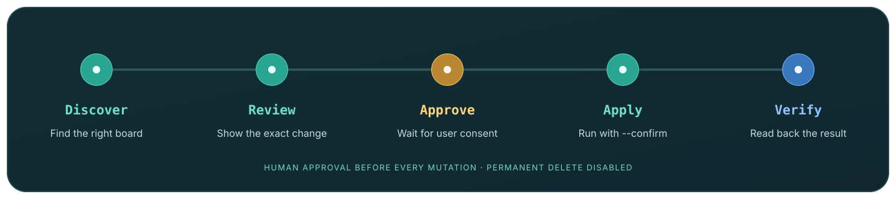
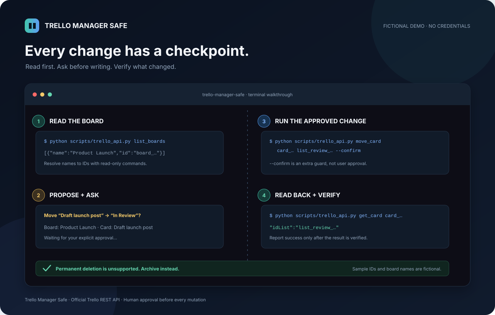

# Trello Manager Safe

[English](README.md) · [Bahasa Indonesia](README.id.md)

## Contents

- [Get the skill](#get-the-skill)
- [License](#license)
- [Setup guide](#setup-guide)
- [What it can do](#what-it-can-do)
- [Safety model](#safety-model)
- [Example interaction](#example-interaction)
- [Repository files](#repository-files)
- [Demo](#demo)
- [Quick start](#quick-start)
- [Install as an agent skill](#install-as-an-agent-skill)
- [How authentication works](#how-authentication-works)
- [Official references](#official-references)
A portable AI agent skill for safely inspecting and managing Trello boards through Trello's official REST API.



> This repository contains an agent skill and a small Python CLI helper. It is not a website, Trello Power-Up, or official Atlassian product.

> **Agent compatibility:** Designed for agents that support the Agent Skills format (SKILL.md) and can run local Python scripts. Installation and environment setup vary by agent.

## Get the skill

Clone this repository to your computer. Install [Git](https://git-scm.com/downloads) first if `git` is not available:

```powershell
git clone https://github.com/Mufid2225/trello-manager-safe.git
cd trello-manager-safe
```

These commands work in PowerShell, macOS, and Linux terminals with Git installed. Alternatively, choose **Code → Download ZIP** on GitHub, extract it, and open a terminal in the extracted `trello-manager-safe` folder. Cloning is recommended because you can update the local copy later with `git pull`.

Keep the cloned folder on your computer. The skill files are `SKILL.md`, `scripts/`, and `agents/`. This skill uses Python, so it does not need `npx` or a remote shell installer.

## What it can do

- Inspect boards, lists, cards, labels, and checklists.
- Create and update boards, lists, cards, labels, and checklist items.
- Move, archive, and restore cards, lists, and boards.
- Block permanent deletion by design.

## Safety model

- Resolve names to IDs with read-only commands before acting.
- Explain the exact target and proposed change before a write.
- Get explicit user confirmation for each mutation; bulk actions require a separate confirmation.
- Execute writes only with `--confirm`, then read back the affected object.
- Never expose credentials or put them in command-line arguments.
- Archive instead of permanently deleting.
- Do not modify members, workspace permissions, visibility, billing, or Power-Ups.

The CLI's `--confirm` flag is a second guardrail, not a substitute for the agent obtaining user approval.

## Example interaction

```text
User: Move “Draft launch post” to “In Review” on the Product Launch board.

Agent: I found the card on the Product Launch board. I propose moving it to
“In Review”. Do you approve this exact change?

User: Yes, move that card.

Agent: I moved it and checked the card again. It is now in “In Review”.
```

The agent must resolve the board, list, and card first, get approval for the specific change, run the helper with `--confirm`, then verify the result. The example uses fictional Trello data.

## Repository files

| Path | Purpose |
|---|---|
| `SKILL.md` | Agent instructions, safety rules, and supported operations |
| `scripts/trello_api.py` | Guarded Trello REST API command-line helper |
| `requirements.txt` | Python dependency used by the helper |
| `agents/openai.yaml` | Optional agent interface metadata |
| `assets/workflow.svg` | Animated overview of the safe workflow |
| `assets/demo-workflow.svg` | Static terminal-style usage demo |
| `README.id.md` | Indonesian version of this README |
| `LICENSE` | MIT license |
| `SECURITY.md` | Private vulnerability reporting guidance |

## Demo



The illustration uses fictional board names and IDs. It shows the read → approval → confirmed change → verification workflow.

## Setup guide

### 1. Create Trello credentials

The helper uses a Trello API key and a user token. Trello's current REST API authorization guide describes this key-and-token flow:

1. Sign in to the Trello account that should be available to the agent.
2. Open [Trello Power-Up admin](https://trello.com/power-ups/admin) and create or select a Power-Up for this integration.
3. Open its **API Key** section and generate an API key. Trello associates API keys with a Power-Up.
4. Use Trello's authorization flow for that key to request a user token. Review the requested permissions and approve only if they match your intended use. Treat the resulting token as a password.
5. Keep both values private. Do not paste them into an AI chat, issue, screenshot, source file, or command argument.

Follow Trello's current [authorization guide](https://developer.atlassian.com/cloud/trello/guides/rest-api/authorization/) if the page labels or flow change. This repository does not create credentials on your behalf.

### 2. Check Python and install the helper dependency

Check that Python 3.10 or later is available:

```powershell
python --version
```

If Python is missing, install it from [python.org](https://www.python.org/downloads/). On Windows, enable the option to add Python to PATH if the installer offers it. Open a new terminal and confirm `python --version` works. If Windows uses the Python launcher, use `py --version` and `py -m pip` instead of `python`.

The `requirements.txt` file is in the cloned repository. In the terminal, change to the repository root (the `trello-manager-safe` folder) before running the install command. This installs the `requests` library required by the helper into the Python environment used by that command; it does not install Trello or change your AI agent.

```powershell
python -m pip install -r requirements.txt
```

### 3. Provide credentials for a session

The helper currently reads `TRELLO_API_KEY` and `TRELLO_API_TOKEN` from the environment of the process that runs it. It does not yet read from Windows Credential Manager, macOS Keychain, or a Linux secret service. The following examples set values for the current shell only; they are cleared when that shell closes.

PowerShell (token input is masked):

```powershell
$env:TRELLO_API_KEY = Read-Host 'Trello API key'
$secureToken = Read-Host 'Trello user token' -AsSecureString
$tokenPtr = [Runtime.InteropServices.Marshal]::SecureStringToBSTR($secureToken)
try {
    $env:TRELLO_API_TOKEN = [Runtime.InteropServices.Marshal]::PtrToStringBSTR($tokenPtr)
} finally {
    [Runtime.InteropServices.Marshal]::ZeroFreeBSTR($tokenPtr)
    $secureToken.Dispose()
    Remove-Variable secureToken, tokenPtr
}
```

macOS/Linux (token input is hidden):

```sh
read -r -p 'Trello API key: ' TRELLO_API_KEY
read -r -s -p 'Trello user token: ' TRELLO_API_TOKEN
printf '\n'
export TRELLO_API_KEY TRELLO_API_TOKEN
```

Run the agent or helper from that same shell so it inherits the variables. This session-only option is preferable on shared or higher-risk devices.

#### Optional: persist credentials in your Windows user environment

This is more convenient because new terminals and applications launched by your Windows user can inherit the values. Windows user environment variables are **not an encrypted credential store**. Choose this only on a trusted, personal Windows account. Any program running as your user may be able to read them. For stronger at-rest protection, use Windows Credential Manager; direct integration is not implemented in this version.

In PowerShell, run the following interactively. The token prompt is masked; the values are not printed by these commands:

```powershell
$apiKey = Read-Host 'Trello API key'
$secureToken = Read-Host 'Trello user token' -AsSecureString
$tokenPtr = [Runtime.InteropServices.Marshal]::SecureStringToBSTR($secureToken)
try {
    $apiToken = [Runtime.InteropServices.Marshal]::PtrToStringBSTR($tokenPtr)
    [Environment]::SetEnvironmentVariable('TRELLO_API_KEY', $apiKey, 'User')
    [Environment]::SetEnvironmentVariable('TRELLO_API_TOKEN', $apiToken, 'User')
    $env:TRELLO_API_KEY = $apiKey
    $env:TRELLO_API_TOKEN = $apiToken
} finally {
    [Runtime.InteropServices.Marshal]::ZeroFreeBSTR($tokenPtr)
    $secureToken.Dispose()
    Remove-Variable apiKey, apiToken, secureToken, tokenPtr -ErrorAction SilentlyContinue
}
```

The settings are saved for your Windows user and also applied to the current PowerShell process. Open a new terminal or restart the AI agent so it inherits the saved settings. Do not use `setx` with a token: command arguments may be exposed to process inspection or shell history.

To remove the saved values later, run:

```powershell
[Environment]::SetEnvironmentVariable('TRELLO_API_KEY', $null, 'User')
[Environment]::SetEnvironmentVariable('TRELLO_API_TOKEN', $null, 'User')
Remove-Item Env:TRELLO_API_KEY, Env:TRELLO_API_TOKEN -ErrorAction SilentlyContinue
```

After either setup option, continue with [Verify access](#4-verify-access).

### 4. Verify access

With the variables set in the current session, run:

```powershell
python scripts/trello_api.py test_connection
python scripts/trello_api.py list_boards
```

The first command checks authentication; the second lists boards visible to that Trello user. If authentication fails, confirm that both variables are set in the same process environment, the token has not expired or been revoked, and its permissions allow the requested operation. Do not print the token while troubleshooting.

### 5. Use the skill

Install the skill files into your agent's personal skill directory as described in [Install as an agent skill](#install-as-an-agent-skill).

## Install as an agent skill

Clone this repository as described in [Get the skill](#get-the-skill), then copy `SKILL.md`, `scripts/`, and `agents/` together into the personal skills directory used by your agent:

| Agent | Personal skill directory |
|---|---|
| Codex | `~/.agents/skills/trello-manager-safe/` |
| Claude Code | `~/.claude/skills/trello-manager-safe/` |
| OpenCode | `~/.config/opencode/skills/trello-manager-safe/` |

On Windows, `~` means your user profile directory (for example, `C:\Users\you`). Create the `trello-manager-safe` folder if it does not exist. Do not separate `SKILL.md` from `scripts/` or `agents/`.

Install `requests` in the same Python environment the agent will use, and make sure the agent process receives `TRELLO_API_KEY` and `TRELLO_API_TOKEN`. When the skill runs, it must invoke the helper by the absolute path to `scripts/trello_api.py` inside the installed skill directory. `SKILL.md` instructs the agent to resolve this path, so it works even when the agent's current directory is another project.

Agent skill discovery can change between releases. Check the agent's current documentation if it does not discover the folder automatically.

## How authentication works

The helper calls `https://api.trello.com/1` over HTTPS and supplies the Trello API key and token as REST API query parameters, as described by Trello's authentication documentation. Query-string credentials can be captured by HTTP debug logs or monitoring if configured to record full URLs. Avoid enabling verbose HTTP logging, do not share logs, and prefer Trello's supported OAuth flow when integrating a multi-user or distributed application. This helper is intended for local use under one user's account.

## License

This project is licensed under the [MIT License](LICENSE).

## Official references

- [Trello REST API introduction](https://developer.atlassian.com/cloud/trello/guides/rest-api/api-introduction/)
- [Trello REST API authorization](https://developer.atlassian.com/cloud/trello/guides/rest-api/authorization/)
- [Trello REST API reference](https://developer.atlassian.com/cloud/trello/rest/api-group-actions/)
- [Trello MCP](https://trello.com/power-ups/mcp)

The REST API itself is an official Trello interface. A script making REST calls is not automatically a policy violation; users must still follow Trello's current terms, authorization requirements, rate limits, and applicable data policies. This repository is community-maintained and unaffiliated with Atlassian.

## Security

Report vulnerabilities privately using GitHub's **Report a vulnerability** feature on the Security tab. If private reporting is unavailable, use the maintainer contact on [@Mufid2225](https://github.com/Mufid2225). Never include credentials or private Trello data in a report. See [SECURITY.md](SECURITY.md).
